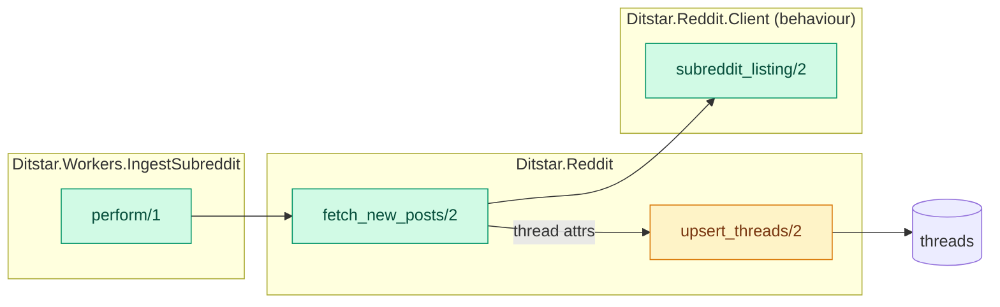

# brainstorm

**Keep messages short.** Say only what was asked or what the reader must act on, in as few lines as it takes: no recaps, no restating, no unasked caveats.

> 🎯 **Design for change.** Judge every option by one question: when this
> changes, how big is the diff? Prefer boundaries and data shapes that keep
> the *next* change small and local.

Take an issue or an idea, think it through with the user, and produce a plan
they can review and then hand to `/implement`. If `.claude/project.md` names
an issue tracker, it stays the source of truth for tickets; never write to it.
If it says tasks are local, `.claude/work/<slug>/` is the record.

Repo facts (tracker, trunk, paths, access rules) are in `.claude/project.md`.
If it's missing, stop: `Run /init first.`

## Phase 1: talk it through (writes nothing)

1. **The input** is the pasted issue description or the user's words. If
   they give only an issue id and the tracker's tools are connected, read the
   issue and its comments; otherwise ask them to paste it. With local tasks,
   the user's words are the input.
2. Read `.claude/project.md`, `CONTEXT.md`, `ARCHITECTURE.md`,
   `docs/MEMORY.md`, the ADRs and API docs that touch the area, and the code
   it touches: router scope, controller or LiveView, context modules, queries,
   API spec schemas (if any), existing tests. Use subagents for broad sweeps.
3. Restate the task in a few lines, in `CONTEXT.md` terms, with what the code
   does today. Point out conflicts with existing behaviour, ADRs or the access
   rules in `.claude/project.md`, and anything in the task that's ambiguous.
4. Converse. Ask a few questions at a time, only what the code can't answer.
   For each open choice, give options with a recommendation and its
   trade-off. Push back on needless coupling, breaking changes for API
   clients, or duplicating what exists.
5. Keep a running list of **agreed** and **open** points. When nothing
   important is open, show it and ask once: "Write the plan?" Write nothing
   until the user says yes.

Commit messages in `plan.md` follow the `git` skill (Conventional Commits).

Useful skills: `design-principles` for module
boundaries, `postgres-dba` for schema changes, `domain-modeling` for ADRs and terms.
Phase 1 writes nothing, even where `domain-modeling` says to update
`CONTEXT.md` right away: keep resolved terms in the agreed list and write them
in Phase 2.

## Phase 2: write the plan

The working docs go in `.claude/work/<slug>/` (gitignored, local only).
`<slug>` follows the slug rule in `.claude/project.md`: the issue id plus a
short name (e.g. `abc-123-member-prices`), or just the short name when tasks
are local (e.g. `member-prices`). Omit `(<issue id>)` from the headings below
when there is none.

| Doc | Where | When |
|---|---|---|
| `plan.md` | `.claude/work/<slug>/` | Always. |
| `stories.md` | `.claude/work/<slug>/` | Always: acceptance criteria. User stories only when there's a user-facing change worth framing. |
| ADR | `docs/adr/NNNN-<slug>.md`, next free number | Only for a decision that's hard to reverse, surprising without context **and** the result of a real trade-off. Via `domain-modeling`, with `status: accepted` (the user agreed it before "Write the plan?"). If it supersedes an older ADR, mark the old one `superseded by ADR-NNNN` now. |
| API change doc | `.claude/work/<slug>/api-changes.md` | Only if the repo serves an API (see `.claude/project.md`) and params, responses, routes or access rules change. A draft of the contract for API clients: what changes, before → after. Local, never committed. `/implement` checks it against the code. |
| Terms | `CONTEXT.md` | Only new or sharpened domain terms. |

### stories.md

```markdown
# <feature> (<issue id>)

## Story (if needed)
As a <specific role>, I want <capability>, so that <outcome>.

## Acceptance criteria
AC1 — <short name>
  Given <state>
  When  <action>
  Then  <one observable outcome>
```

Happy paths first, then errors and edge cases (validation, not found,
unauthorized, and each access rule from `.claude/project.md`). One outcome
per `Then`. Never invent criteria the conversation didn't agree.

### plan.md

```markdown
# Plan: <feature> (<issue id>)
Status: planned
API changes: .claude/work/<slug>/api-changes.md   (or: none)
ADR: docs/adr/NNNN-<slug>.md  (or: none)

## Approach
<a short paragraph: the design, and what was rejected>

## Change diagram
<Mermaid: the whole feature — every module and function it adds, changes or
removes, and the calls between them. See *Change diagrams*.>

## Tasks
- [ ] **1. <unit of work>** — criteria: AC1, AC2
  Files: `lib/…`, `test/…`
  Commit: `feat(<scope>): <message>`
  Diagram:
  <Mermaid: only this task's slice of the change diagram>
```

- Tasks in dependency order, one seam each; each becomes one commit, so each
  must review on its own and leave the suite green.
- Each task names its criteria, the files it owns (code and tests) and its
  commit message.
- **Wire tasks are required.** Each entry point touched (a route in the
  router, a LiveView, a background worker) gets a `wire:` task whose
  acceptance is a request through the router in the endpoint test case, the
  LiveView via `live/2`, or `Worker.perform/1`.
- If params or responses change and `.claude/project.md` lists an API spec, a
  task updates the API spec schemas.

- Every plan has a **Change diagram**, and every task a **Diagram** of its
  own slice. No task without a diagram.

### Change diagrams

Every change is visualised as a Mermaid `flowchart LR`, so the user sees
which modules and functions move before reading any code:

- **Modules are subgraphs**, titled with the full module name
  (`Ditstar.Reddit.Ingest`). Group them left to right by layer: entry point
  (router, LiveView, controller, Oban worker) → context → schema / external
  client.
- **Functions are nodes**, labelled `name/arity`. Schemas show as a node
  labelled with the table name; a migration as a node `migration: <name>`.
- **Edges are calls** (`-->`), labelled with what flows when it isn't obvious
  (`-->|thread attrs|`).
- **Colour by change**, with these class definitions at the top of each
  diagram: green `added`, amber `changed`, red dashed `removed`. Show
  unchanged neighbours plain, and only those needed to see where the change
  plugs in.



Re-running on an existing slug refines the docs in place and sets
`Status: planned`.

## Hand off

List the docs written with their paths, the tasks (one line each, with
commit messages), then:
`Review the docs and ask for changes here. When you're happy: /implement`
