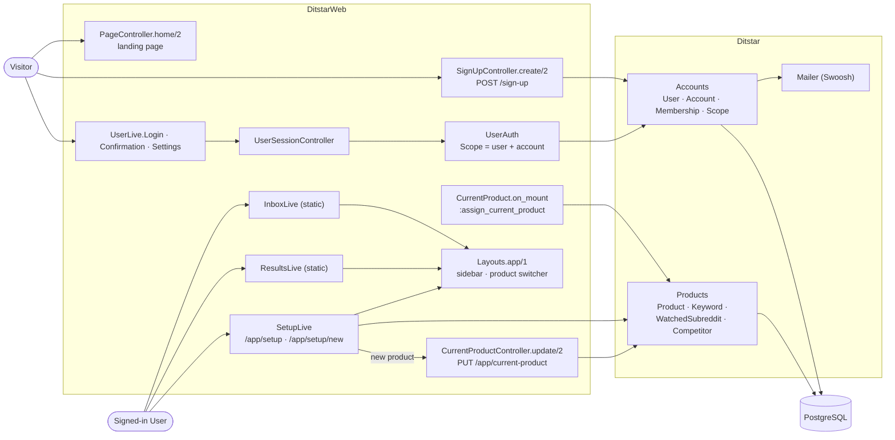

# Architecture

How Ditstar is built today. Planned work lives in `docs/ROADMAP.md`, `.claude/work/` plans and `docs/adr/`, not here.

## Overview

A visitor creates an account from the landing page and signs in with a magic link. Signed-in Users manage their Account's Products in Setup, and switch between Products in the sidebar. Inbox and Results are static screens for now (M3 and M6 give them data).

## Stack

- Elixir ~> 1.17, Phoenix 1.8, Phoenix LiveView 1.2, Bandit
- Ecto with PostgreSQL (`Ditstar.Repo`)
- phx.gen.auth (magic link; bcrypt for the optional password)
- Tailwind v4 and esbuild; design tokens in `assets/css/tokens.css`, fonts self-hosted in `priv/static/fonts/`
- Swoosh for email, Req for HTTP
- Styler, Credo (`--strict`) and ex_slop, all run by `mix precommit`

## Contexts

| Context | Owns | Entry points |
|---|---|---|
| `Ditstar.Accounts` | `users`, `users_tokens`, `accounts`, `account_memberships` | `sign_up/2`, `register_user/1` (User, Account and Membership in one transaction), `account_for_user/1`, generated session and magic-link functions |
| `Ditstar.Products` | `products`, `keywords`, `watched_subreddits`, `competitors` | `list_products/1`, `get_product/2`, `change_product/3`, `save_product/3`, `managed_posting_enabled?/0`; all take the `Scope` |

`Ditstar.Accounts.Scope` carries the User and the Account of their first Membership. Every `Ditstar.Products` function filters by `scope.account`, so tenancy is enforced in that one module. Products doesn't call Accounts; it only reads the Scope it's given.

## Web

| Scope | Pipeline | Serves |
|---|---|---|
| `/` | `:browser` | Landing page (`PageController`), `POST /sign-up` (`SignUpController`) |
| `/users/log-in`, `/users/log-out` | `:browser` | Magic-link sign-in (`UserLive.Login`, `UserLive.Confirmation`, `UserSessionController`) |
| `/users/settings` | `:browser`, `:require_authenticated_user` | `UserLive.Settings` (sudo mode) |
| `/app` | `:browser`, `:require_authenticated_user` | `live_session :app` (`UserAuth :require_authenticated`, then `CurrentProduct :assign_current_product`): `InboxLive`, `ResultsLive`, `SetupLive`; plus `PUT /app/current-product` |
| `/dev` | `:browser` (dev only) | LiveDashboard, Swoosh mailbox |

- **Current Product:** the id is kept in the session. LiveViews can't write the session, so the switcher and Setup (after creating a product) submit a `PUT /app/current-product` form, the second one through `phx-trigger-action`. The `on_mount` hook resolves the id against the Account's Products, falling back to the first.
- **Layouts:** `Layouts.landing/1` (light marketing page), `Layouts.auth/1` (sign-in card), `Layouts.app/1` (slate shell with sidebar). Shared UI pieces are function components in `DitstarWeb.UI`; new screens don't use daisyUI.
- **Managed posting:** the "Ditstar, labelled" default-poster choice appears only when `config :ditstar, managed_posting_enabled: true` (off by default).

## Background work

None yet. Oban comes with M2 (ingest).

## Data

| Table | Owner | Notes |
|---|---|---|
| `users`, `users_tokens` | Accounts | Generated by phx.gen.auth |
| `accounts` | Accounts | The tenant; id and timestamps only |
| `account_memberships` | Accounts | Junction table (no id), unique on (account_id, user_id); no roles yet |
| `products` | Products | `account_id`, `name`, `website`, `description`, `default_poster` (`own_account` / `managed_account`) |
| `keywords`, `watched_subreddits`, `competitors` | Products | `product_id` plus one value each; unique per Product, ignoring case. Subreddit names are stored normalized (`r/SaaS` becomes `saas`). |

No table prefixes yet.

## External services

Email through Swoosh: the local adapter in dev (`/dev/mailbox`), the test adapter in tests. There's no production adapter yet; that comes with the deploy slug.

## Decisions

- [ADR-0001](docs/adr/0001-sign-up-creates-an-account.md): sign-up creates an account; tenancy goes through memberships.

## Layout

| Path | What goes there |
|---|---|
| `lib/ditstar/` | Contexts (`Ditstar.*`): domain logic, Ecto schemas, queries |
| `lib/ditstar_web/` | Web layer (`DitstarWeb.*`): router, controllers, LiveViews (`live/`), components (`components/ui.ex`, `components/layouts.ex`) |
| `priv/repo/migrations/` | Migrations (generate with `mix ecto.gen.migration`) |
| `priv/repo/seeds.exs` | Dev seed: `dev@ditstar.local` with one Product |
| `test/ditstar/` | Context tests, mirroring `lib/ditstar/` |
| `test/ditstar_web/` | Controller tests in `controllers/<controller>/<action>_test.exs`, LiveView tests in `live/` |
| `test/support/` | `ConnCase`, `DataCase`, fixtures in `fixtures/` |
| `docs/design/` | Design handoff: reference HTML, screenshots, tokens, fonts |

## Where new code goes

- A new domain area gets its own context module under `lib/ditstar/`, owning its schemas and tables, and taking the `Scope`.
- Every record is scoped to an Account (see `CONTEXT.md`).
- UI is LiveView, under `lib/ditstar_web/live/`, inside `Layouts.app/1`, built from `DitstarWeb.UI` components and token utilities.
- Background work goes in Oban workers under `lib/ditstar/workers/` once Oban is added.
