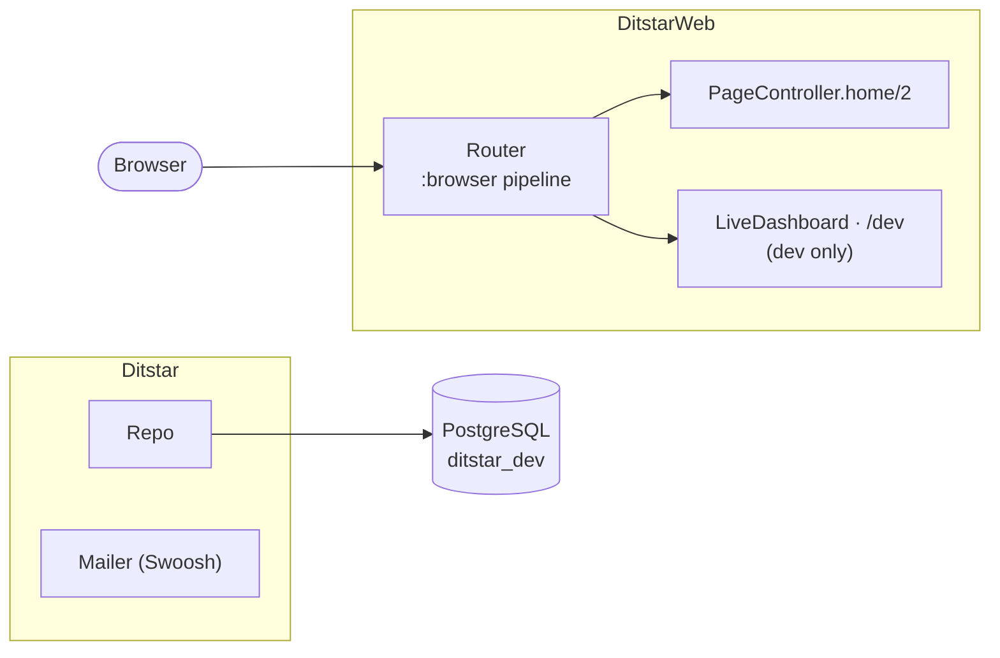

# Architecture

How Ditstar is built today. Planned work lives in `.claude/work/` plans and `docs/adr/`, not here.

## Overview

Fresh `phx.new` app: no domain code yet. The target design is in `docs/ROADMAP.md`.

## Stack

- Elixir ~> 1.17, Phoenix 1.8, Phoenix LiveView 1.2, Bandit
- Ecto with PostgreSQL (`Ditstar.Repo`)
- Tailwind v4 and esbuild for assets
- Swoosh for email, Req for HTTP

## Layout

| Path | What goes there |
|---|---|
| `lib/ditstar/` | Contexts (`Ditstar.*`): domain logic, Ecto schemas, queries |
| `lib/ditstar_web/` | Web layer (`DitstarWeb.*`): router, controllers, LiveViews, components |
| `lib/ditstar_web/router.ex` | Routes: `:browser` pipeline at `/`, dev tools at `/dev` |
| `priv/repo/migrations/` | Migrations (generate with `mix ecto.gen.migration`) |
| `test/ditstar/` | Context tests, mirroring `lib/ditstar/` |
| `test/ditstar_web/` | Controller and LiveView tests |
| `test/support/` | `DitstarWeb.ConnCase`, `Ditstar.DataCase`, and fixtures once added |

## Where new code goes

- A new domain area gets its own context module under `lib/ditstar/`, owning its schemas and tables.
- Every record is scoped to an Account (see `CONTEXT.md`).
- UI is LiveView, under `lib/ditstar_web/live/`.
- Background work goes in Oban workers under `lib/ditstar/workers/` once Oban is added.
