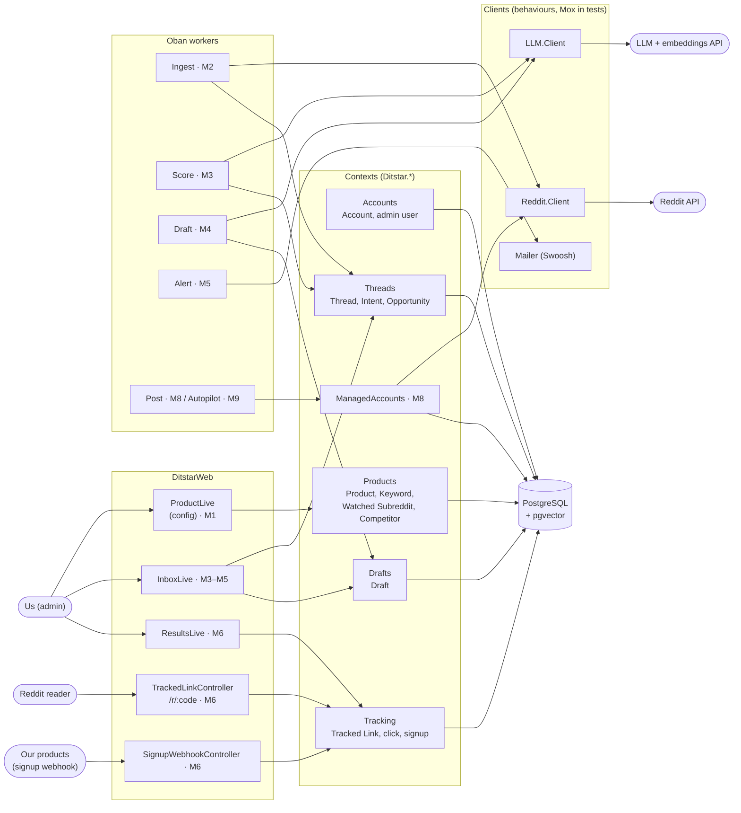

# Roadmap

Milestones for phase 1 (internal), from `README.md`. Terms are defined in `CONTEXT.md`.

Each milestone ends with something we can use on our own products. Each one becomes a `/brainstorm` slug, where its user stories and plan are written.

```
M1 Foundations ─► M2 Ingest ─► M3 Score + Inbox ─► M3b Instant setup ─► M4 Drafts ─► M5 Alerts & triage ─► M6 Tracking ─► M7 Dogfood gate
                                                                                                  └─► M8 Managed accounts ─► M9 Autopilot
```

## How it works for the user

The target flow (owner, 2026-11-18). Every milestone is measured against it.

1. **Create an account, then paste your site's URL or describe your product.** Sign-up asks only for an email. Right after it, a guided step asks for the URL (Ditstar reads the site) or a pasted product description, and fills in the Product: name, description and voice. Then the app opens.
2. **We pick the Reddit channels for you.** It suggests Watched Subreddits, Keywords and Competitors; you remove what doesn't fit.
3. **Pick how many replies to post, and when.** For example 3 a day, weekdays, 9–17 in your time zone.
4. **Get your first replies.** Drafts for the best Opportunities arrive in the Inbox, paced to your schedule.
5. **Accept each one, or put it on autopilot.** Accept: copy it and open the thread, or approve a batch. Autopilot: Ditstar posts within your schedule and rules.

## Target architecture

Where the milestones lead. This is planned, not built: `ARCHITECTURE.md` shows what exists today. Module names are working names, and each milestone's `/brainstorm` settles them.



Pipeline: `Ingest → Score → (Opportunity) → Draft → Alert`, each step an Oban job enqueued by the one before it.

---

## M1 — Foundations

**Goal:** the app is deployed, protected, and holds what we watch.

- Oban added, with a queue layout for ingest, score and draft.
- The tenancy model: Account → Product → Keyword, Watched Subreddit, Competitor. Every table is scoped to an Account.
- An admin login for us, with no public signup (`phx.gen.auth` with registration closed).
- LiveView screens to manage Products and their Keywords, Watched Subreddits and Competitors.
- Deployment with secrets in env vars.

**Done when:** we can log in on the deployed app and configure our real Products.

## M2 — Ingest

**Goal:** new Reddit posts and comments land in the database.

- A Reddit API client behind a behaviour (Mox in tests), using OAuth and respecting rate limits.
- A scheduled Oban job per Product that pulls new posts and comments from Watched Subreddits, and keyword and Competitor search results.
- Threads stored once (deduplicated on the Reddit id), keeping where they came from: which Product, and which Keyword or subreddit matched.
- A plain list of the latest Threads per Product, to sanity-check what comes in.

**Done when:** ingest runs on its own for a day without gaps or duplicates.

## M3 — Score + Inbox

**Goal:** only the threads worth answering reach us, ranked.

- An embedding for each Thread and Product description (pgvector), with a similarity cut-off before any LLM call, to control cost.
- An LLM classifies the Intent of the remaining Threads (looking for a recommendation, unhappy with a Competitor, noise), with a short reason.
- A score and a per-Product threshold. Threads above it become Opportunities.
- An Inbox LiveView with Opportunities ranked by score, each opening the Thread on Reddit.
- Model calls behind a behaviour, with token usage logged per Account.

**Done when:** a week of Inbox output looks mostly right to us, and the cost per day is known.

## M3b — Instant setup (after M3)

**Goal:** after sign-up, paste a URL or a description and Setup fills itself (flow steps 1–2).

- Fetch the site with Req (title, meta, main text). The LLM writes the Product description and voice notes, and suggests Keywords and Competitors.
- Suggest Watched Subreddits: the LLM proposes them, the Reddit API (M2) checks they exist and are active, and they're ranked by fit.
- Onboarding after sign-up: a User whose Account has no Products lands on a guided step (URL, or paste a description) instead of the empty app. Submitting it creates the Product and opens Setup with the suggestions.
- Setup shows the suggestions as pre-filled chips you can remove. Manual Setup from M1 stays as the review and edit screen.
- Errors are handled: unreachable site, thin content, no good subreddits (falls back to manual entry).

**Done when:** pasting our own products' URLs gives a Setup we'd keep with only small edits, and the first Opportunities show up without typing a keyword.

## M4 — Drafts

**Goal:** each Opportunity comes with a reply worth posting.

- A Draft generated per Opportunity from the Thread, the Product context and the Account's voice (voice notes and example replies on the Product).
- Regenerate, and edit in place.
- Copy the Draft, then open the Thread to paste it.
- Drafts generated in the background, only for Opportunities.

**Done when:** most Drafts need only light edits before we post them.

## M5 — Alerts & triage

**Goal:** we don't have to keep the Inbox open.

- Opportunity status: new → replied / dismissed, with filters in the Inbox.
- Alerts for new high-score Opportunities, by email (Swoosh) first; a digest or instant per Product.
- Dismiss reasons, fed back to tune thresholds.
- Posting schedule per Product (flow step 3): how many replies a day and in which time windows, in the Account's time zone. The Inbox and digest offer that many Drafts per window; the rest wait in a queue ranked by score.
- Autopilot, part 1: a daily digest with Drafts ready to go, and batch review (approve or skip many Opportunities in one pass).

**Done when:** we act on Opportunities from alerts and batch review instead of polling.

## M6 — Tracking

**Goal:** we can see which replies bring visits and signups.

- Tracked Links: a short redirect (`/r/<code>`) per Opportunity and Product, inserted into the Draft.
- Click events recorded on redirect.
- A signup signal from our products (a webhook or a pixel) attributed to the Tracked Link.
- A results view: clicks and signups per Thread, Product and subreddit.

**Done when:** we can show traffic and signups that came from Ditstar.

## M7 — Dogfood gate

**Goal:** decide whether to start phase 2 (SaaS).

- Run on our products and tune the thresholds and prompts.
- A short report: Opportunities per week, reply rate, clicks, signups, LLM cost.
- The decision recorded in `docs/MEMORY.md`.

**Done when:** go / no-go on SaaS, with numbers.

## M8 — Managed accounts (after M6)

**Goal:** Ditstar posts approved Drafts from accounts it operates, as disclosed Paid Placements.

- Managed Accounts stored with their Reddit credentials (encrypted).
- An approval step: nothing posts without an approved Draft.
- The disclosure is enforced in the reply text, and the account profile is checked.
- Subreddit rules are recorded, and posting is blocked where promotion isn't allowed.
- Posting through the Reddit API, with the posted comment linked back to the Opportunity.

**Done when:** an approved Draft posts with its disclosure, and posting into a disallowed subreddit is refused.

## M9 — Autopilot (after M7 and M8)

**Goal:** Ditstar replies on its own, within rules the customer sets, without hurting the customer's name on Reddit.

- Autopilot rules per Product, opt-in: which Intents, the minimum score and which subreddits get a reply without manual approval.
- Posted from Managed Accounts only, every reply labelled as a paid placement, and only in subreddits whose rules allow promotional replies (the M8 guardrails apply unchanged).
- Posts only within the Product's posting schedule (M5), never above its daily count. Hard rate limits per account and subreddit on top, plus a kill switch per Product and a global one.
- A log of every autopilot reply, with undo (delete the comment) and alerts when a reply is removed, downvoted or reported.
- Quality checks before posting: the Draft passes a review step (rules plus an LLM check), and anything uncertain falls back to manual approval.
- An ADR recording the guardrails and why each exists.

**Done when:** autopilot replies run for our own products for two weeks within the limits, with no removed replies and no account actions from Reddit, and the kill switch stops posting immediately.

---

## Before going live

Ditstar doesn't go public until everything the landing page promises works (owner, 2026-11-18):

- [ ] Guided onboarding after sign-up: paste a URL or a description, then the app opens (M3b)
- [ ] Suggested subreddits, keywords and competitors from the site (M3b)
- [ ] Posting schedule per Product: replies a day and time windows (M5)
- [ ] Drafts you approve, one by one or in a batch (M4, M5)
- [ ] Autopilot within your schedule and rules, labelled when Ditstar posts (M9)
- [ ] Tracked links with visits and signups (M6)
- [ ] Production email adapter and deploy (deploy slug)
- [ ] The landing page's founder note and `[YOUR PHOTO]`, `[YOUR PRODUCT]`, `[COMPETITOR]` placeholders replaced with real content

If one of these slips, change the landing copy before launch instead of shipping a promise the product doesn't keep.

## Later — Phase 2 (SaaS)

Out of scope until M7 says go: self-serve signup and onboarding, billing and plan limits, posting from the customer's own Reddit account through OAuth, and agency support for several Accounts per user.

## Open decisions

To settle in the milestone's `/brainstorm`, or earlier when they block:

1. **Reddit API access (blocks M2).** Commercial use of Reddit's Data API needs Reddit's approval and may be paid, so check the terms and quotas before building ingest. M8's automated posting raises the same question more sharply.
2. **LLM and embedding providers (M3).** Which models to use for classification, drafting and embeddings, and where the cost cap sits.
3. **Hosting (M1).** Fly.io, Gigalixir, a VPS or something else. This affects Postgres with pgvector.
4. **Admin auth (M1).** Closed `phx.gen.auth` versus basic auth for the internal phase.
5. **Signup signal (M6).** How our own products report a signup back to Ditstar.
6. **Autopilot posting (M9).** We're aiming for it (owner, 2026-11-18). Before building, check Reddit's API terms and its rules for automated accounts, and use the M7 numbers to set the limits. Posting from the customer's own account on autopilot is out of scope until that check is done.
