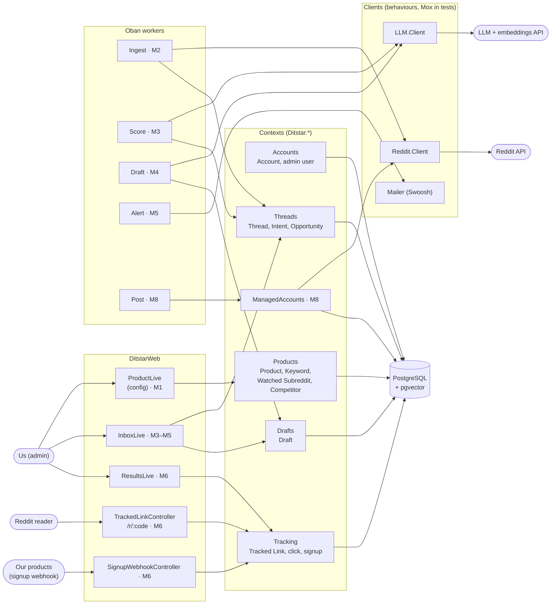

# Roadmap

Milestones for phase 1 (internal), from `README.md`. Terms are defined in `CONTEXT.md`.

Each milestone ends with something we can use on our own products. Each one becomes a `/brainstorm` slug, where its user stories and plan are written.

```
M1 Foundations ─► M2 Ingest ─► M3 Score + Inbox ─► M4 Drafts ─► M5 Alerts & triage ─► M6 Tracking ─► M7 Dogfood gate
                                                                                                  └─► M8 Managed accounts (optional)
```

## Target architecture

Where the milestones lead. This is planned, not built: `ARCHITECTURE.md` shows what exists today. Module names are working names, and each milestone's `/brainstorm` settles them.



Pipeline: `Ingest → Score → (Opportunity) → Draft → Alert`, each step an Oban job enqueued by the one before it.

---

## M1 — Foundations

**Goal:** the app is deployed, protected, and holds what we watch.

- Oban added, with a queue layout for ingest, score and draft.
- The tenancy model: Account → Product → Keyword, Watched Subreddit, Competitor. Every table is scoped to an Account.
- An admin login for us, with no public signup (`phx.gen.auth` with registration closed).
- LiveView screens to manage Products and their Keywords, Watched Subreddits and Competitors.
- Deployment with secrets in env vars.

**Done when:** we can log in on the deployed app and configure our real Products.

## M2 — Ingest

**Goal:** new Reddit posts and comments land in the database.

- A Reddit API client behind a behaviour (Mox in tests), using OAuth and respecting rate limits.
- A scheduled Oban job per Product that pulls new posts and comments from Watched Subreddits, and keyword and Competitor search results.
- Threads stored once (deduplicated on the Reddit id), keeping where they came from: which Product, and which Keyword or subreddit matched.
- A plain list of the latest Threads per Product, to sanity-check what comes in.

**Done when:** ingest runs on its own for a day without gaps or duplicates.

## M3 — Score + Inbox

**Goal:** only the threads worth answering reach us, ranked.

- An embedding for each Thread and Product description (pgvector), with a similarity cut-off before any LLM call, to control cost.
- An LLM classifies the Intent of the remaining Threads (looking for a recommendation, unhappy with a Competitor, noise), with a short reason.
- A score and a per-Product threshold. Threads above it become Opportunities.
- An Inbox LiveView with Opportunities ranked by score, each opening the Thread on Reddit.
- Model calls behind a behaviour, with token usage logged per Account.

**Done when:** a week of Inbox output looks mostly right to us, and the cost per day is known.

## M4 — Drafts

**Goal:** each Opportunity comes with a reply worth posting.

- A Draft generated per Opportunity from the Thread, the Product context and the Account's voice (voice notes and example replies on the Product).
- Regenerate, and edit in place.
- Copy the Draft, then open the Thread to paste it.
- Drafts generated in the background, only for Opportunities.

**Done when:** most Drafts need only light edits before we post them.

## M5 — Alerts & triage

**Goal:** we don't have to keep the Inbox open.

- Opportunity status: new → replied / dismissed, with filters in the Inbox.
- Alerts for new high-score Opportunities, by email (Swoosh) first; a digest or instant per Product.
- Dismiss reasons, fed back to tune thresholds.

**Done when:** we act on Opportunities from alerts instead of polling.

## M6 — Tracking

**Goal:** we can see which replies bring visits and signups.

- Tracked Links: a short redirect (`/r/<code>`) per Opportunity and Product, inserted into the Draft.
- Click events recorded on redirect.
- A signup signal from our products (a webhook or a pixel) attributed to the Tracked Link.
- A results view: clicks and signups per Thread, Product and subreddit.

**Done when:** we can show traffic and signups that came from Ditstar.

## M7 — Dogfood gate

**Goal:** decide whether to start phase 2 (SaaS).

- Run on our products and tune the thresholds and prompts.
- A short report: Opportunities per week, reply rate, clicks, signups, LLM cost.
- The decision recorded in `docs/MEMORY.md`.

**Done when:** go / no-go on SaaS, with numbers.

## M8 — Managed accounts (optional, after M6)

**Goal:** Ditstar posts approved Drafts from accounts it operates, as disclosed Paid Placements.

- Managed Accounts stored with their Reddit credentials (encrypted).
- An approval step: nothing posts without an approved Draft.
- The disclosure is enforced in the reply text, and the account profile is checked.
- Subreddit rules are recorded, and posting is blocked where promotion isn't allowed.
- Posting through the Reddit API, with the posted comment linked back to the Opportunity.

**Done when:** an approved Draft posts with its disclosure, and posting into a disallowed subreddit is refused.

---

## Later — Phase 2 (SaaS)

Out of scope until M7 says go: self-serve signup and onboarding, billing and plan limits, posting from the customer's own Reddit account through OAuth, and agency support for several Accounts per user.

## Open decisions

To settle in the milestone's `/brainstorm`, or earlier when they block:

1. **Reddit API access (blocks M2).** Commercial use of Reddit's Data API needs Reddit's approval and may be paid, so check the terms and quotas before building ingest. M8's automated posting raises the same question more sharply.
2. **LLM and embedding providers (M3).** Which models to use for classification, drafting and embeddings, and where the cost cap sits.
3. **Hosting (M1).** Fly.io, Gigalixir, a VPS or something else. This affects Postgres with pgvector.
4. **Admin auth (M1).** Closed `phx.gen.auth` versus basic auth for the internal phase.
5. **Signup signal (M6).** How our own products report a signup back to Ditstar.
